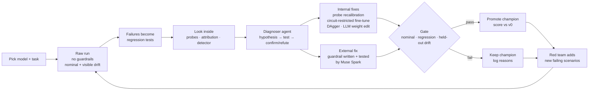
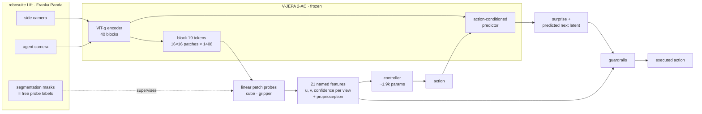
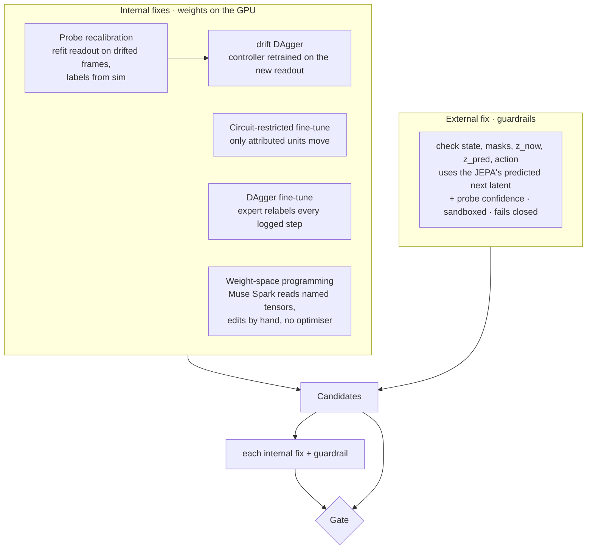
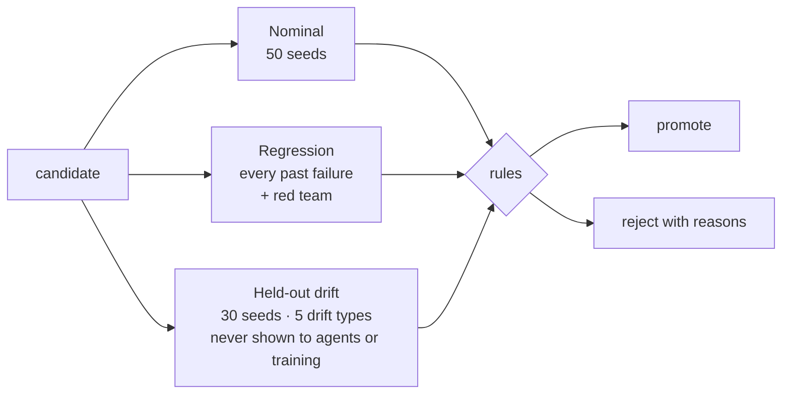
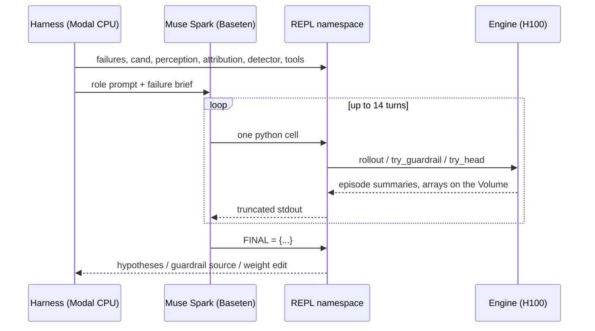
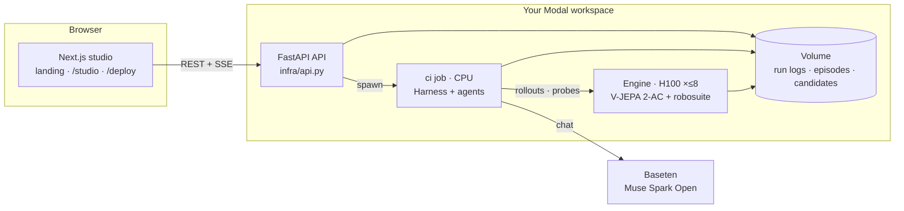

# EmbodiedCI

**Continuous integration for JEPA world models.** You pick a world model and a robot task. EmbodiedCI then:

1. runs the model raw, with no guardrails, and turns every failure into a regression test;
2. looks *inside* the model to find whether perception or control broke;
3. fixes the failure in the weights and with LLM-written guardrails;
4. promotes a fix only when a held-out gate passes it.

The setup is reproducible: the same seeds, the same suites and a JSONL log of every step.

Built for the Meta Global AI Developer Hackathon 2026, with two Meta models:

| Model | Role | Runs on |
|---|---|---|
| **V-JEPA 2-AC** (ViT-g encoder, 1B params, plus an action-conditioned predictor, 300M) | The model under test. Its encoder feeds the probes; its predictor gives surprise and consequence prediction | Modal H100 or your own GPU, with weights in memory |
| **Muse Spark Open** (`meta-models/muse-spark-open-1026`) | The harness's subagents: diagnoser, weight editor, guardrail writer, red team | Baseten Model APIs |

---

## Why

A world-model policy that works on the demo seed tells you little. The useful questions come after:

- What breaks it?
- Is the cause in what it *sees* or in what it *does*?
- Can it be fixed without breaking what already worked?

These are the questions CI answers for code. EmbodiedCI asks them of an embodied model, and it does the work an engineer would otherwise do by hand: rollouts, triage, probing, patching and regression testing.

## The loop



## Inside the JEPA

A failure has a location. Before changing anything, EmbodiedCI measures where the failure lives.



Three instruments run on every round:

| Instrument | What it measures | How |
|---|---|---|
| **Patch probes with a layer sweep** | Can object position be read linearly from the encoder, and at what depth? | One logistic probe per object scores every 16×16 patch. Labels are sim segmentation coverage. Soft-argmax over the patch logits gives sub-patch position. The sweep covers blocks 9 / 19 / 29 / 39 |
| **Attribution over the controller** | Which controller units and input features carry the failing behaviour? | \|activation × gradient\| of the imitation loss on failing steps, scored per unit |
| **Failure-ahead detector** | Do the model's own signals predict a failure before it happens? | A logistic probe on [features, JEPA surprise] that predicts a failure within 5 steps. It reports AUROC and the share of held-out failures caught at a 10% false-alarm rate |

**What we measured on V-JEPA 2-AC** (run `run-20261104-110352`, 944 frames, nominal only):

| Encoder block | Cube error (px, median) | Gripper error (px, median) | Patch AUROC |
|---|---|---|---|
| 9 | 2.4 | 11.6 | 0.9998 |
| **19** (selected) | **1.8** | **4.2** | 0.9999 |
| 29 | 2.1 | 4.8 | 0.9999 |
| 39 (output) | 2.0 | 3.9 | 0.9999 |

Object position is linearly decodable to about 2 px on a 256 px image (16 px patches), so localisation is sub-patch. The gripper, an articulated object, only becomes readable from mid-depth onwards. This is consistent with the intermediate-depth "emergence zone" that Joseph et al. (2026) report for physical variables in V-JEPA 2.

## Fixing: inside and outside



Design choices:

- **The controller is deliberately tiny.** It has ~1.9k parameters and reads 21 named inputs. This lets the weight editor read the whole controller as text and make edits whose meaning can be checked. An edit like `fc1[24] ← gripper_closed, cube_v_agent` is legible. The idea follows the *weight-space programming* result: locate the cause first, keep the edit small, verify on held-out data. Edits remove obstacles; they don't add abilities the model lacks.
- **Perception fixes are data fixes.** When the probe misreads a blue cube, no hand edit to the controller can recover the information. Recalibrating the readout on sim-labelled frames can, because the encoder still represents the cube.
- **Guardrails act before the consequence.** A guardrail receives the predictor's latent for the proposed action, so it can clip a descent that the model itself predicts will hit the table.

## The gate

Every candidate is scored against the current champion on the same seeds, with bootstrap confidence intervals.



A candidate is promoted only if all of these hold:

- Nominal success does not fall (one episode of slack in 50).
- Unsafe actions executed on nominal do not rise.
- Guardrails block at most 5% of nominal steps.
- Every regression test that passed still passes.
- Held-out drift success does not fall by more than 5 points, so a fix cannot overfit to the visible failures.
- At least one regression test is fixed.

## Agents: a REPL-driven harness

Each subagent's only tool is a persistent Python REPL, and large context lives in variables rather than the prompt: episodes, tensors, weights and probe reports. Each turn is a single cell, and the agent ends by assigning `FINAL`.



Round 1's diagnoser output (abridged). It used the probes and refuted one of its own hypotheses:

- **Confirmed: cube_color, no lift.** The side-view probe misreads the blue cube by 5–9 px, and its confidence falls to 0.54 against 0.78 on nominal. The controller hovers and never closes the gripper. JEPA surprise does not react.
- **Refuted: camera_shift caused by perception.** The probes still localise the cube in the shifted image. What breaks is the learned image-to-world mapping.
- **Confirmed: dim_light, unsafe.** The probes are fine (2.2 px), but depth control overshoots into the table.

## Results so far

The baseline v0 controller was trained on nominal demos only (BC plus one DAgger pass). It was scored on the gate suites:

| Condition | Safe success | Diagnosis |
|---|---|---|
| nominal (50 seeds) | 86% | competent |
| low_friction ×0.05 | 100% | robust |
| heavy_cube ×20 | 83% | control: too fast under load |
| dim_light ×0.25 | 67% | control: depth overshoot (perception intact) |
| cube_color (blue) | 0% | perception: probe misreads the cube |
| camera_shift (9 cm) | 0% | control: image-to-world mapping |
| **held-out drift overall** | **50%** | |

The failure-ahead detector scores AUROC 0.931 on held-out episodes and catches 8/8 failures at a 10% false-alarm rate, about 1 step ahead. An earlier figure of 0.974 was measured with a labelling bug that marked successful episodes as failures; 0.931 is the corrected number.

### Round 1 gate (run `run-20261104-114219`, internal fixes only, no agents)

Every candidate was scored on the same seeds as v0. In this run v0 measured 92% nominal and 53% held-out drift. Re-running the same seeds varies by a few points between runs, because of bf16 inference and the simulator.

| Candidate | Nominal | Held-out drift | Regression tests fixed | Gate |
|---|---|---|---|---|
| DAgger fine-tune | 98% | 63% | 6 | **promoted** |
| Circuit-restricted fine-tune | 94% | 40% | 3 | rejected: held-out drift fell 53% → 40% (overfit to visible failures) |
| Probe recalibration + drift DAgger | 96% | **93%** | 14 | rejected: unsafe actions on nominal rose |

Probe recalibration is the fix the interpretability pointed to. It cut held-out drift failures from 47% to 7%, **6.7× fewer**: the blue cube and the moved camera went from 0% to mostly solved. The gate still refused it, because it executed more unsafe actions on nominal than v0 did. The promoted champion is the safer, smaller win: held-out failures fell 1.27×, and nominal rose from 92% to 98%. Round 2 built that next candidate: recalibration plus a safety envelope.

### Round 2 gate (run `run-20261104-235115`, 1 H100, Muse Spark agents on)

Gated against the round 1 champion (98% nominal, 63% held-out drift). Rejected candidates stop after the nominal suite, so their held-out score is not measured (–).

| Candidate | Nominal | Held-out drift | Regression tests fixed | Gate |
|---|---|---|---|---|
| **Probe recalibration + safety envelope** | **100%** | **100%** | 11 | **promoted** |
| Probe recalibration | 96% | – | – | rejected: unsafe actions on nominal rose |
| DAgger fine-tune | 94% | – | – | rejected: nominal success fell |
| Muse Spark guardrail | 100% | – | – | rejected: blocks 36% of nominal steps (max 5%) |
| Recalibration + Muse Spark guardrail | 100% | – | – | rejected: blocks 37% of nominal steps |

**v0 failed 18 of the 80 gate episodes (77.5% safe success). The round 2 champion fails none (50/50 nominal, 30/30 held-out drift).** With zero failures the reduction factor is bounded only by sample size: at least 18× on these seeds (14× on held-out drift alone). With 80 episodes, the 95% confidence interval for its true success rate still reaches down to about 95%.

What made the difference:
- **Sturdier probe readout.** Position comes from a window around the strongest patch, not all 256 patches, and the last confident position is held while the object is hidden. Before, a faint or hidden cube pulled the estimate to the image centre.
- **Recalibration on drift frames.** The cube probe was refit on frames that include the blue cube, the moved camera and dim light.
- **A safety envelope.** An external fix that clips each action back inside the speed, table and workspace limits rather than stopping. It changed 0.66% of nominal steps, which removed the table contact that got recalibration rejected in round 1.

The Muse Spark guardrail writer produced a guardrail that never let an unsafe action through. It also steered the arm using the simulator's true cube position, which a real robot does not have, and it rewrote more than a third of all actions. The gate rejected it on the 5% block-rate rule.

The diagnoser agent also found, and confirmed against the logs, why the moved camera fails. The side-camera **gripper** probe is off by 24–30 px, so the controller commands large upward moves and breaks the speed limit. The cube probe stays within 1–4 px.

### Before and after, episode by episode

The studio's "Before and after" step plays v0 and a candidate side by side on the same 30 held-out seeds (6 per drift). Counts are episodes lifted safely.

| Drift | v0 | Round 1 champion (DAgger) | Round 1 recalibrated (rejected) | **Round 2 champion** |
|---|---|---|---|---|
| low_friction | 6/6 | 6/6 | 5/6 | 6/6 |
| heavy_cube | 6/6 | 6/6 | 6/6 | 6/6 |
| dim_light | 4/6 | 6/6 | 6/6 | 6/6 |
| cube_color | 0/6 | 1/6 | 6/6 | **6/6** |
| camera_shift | 0/6 | 0/6 | 5/6 | **6/6** |
| **total** | 16/30 | 19/30 | 28/30 | **30/30** (14 fixed, 0 broken) |

### SAM 3.1 labels (Meta Model API)

Probe labels can come from Meta SAM 3.1, through the Meta Model API, instead of the simulator (`--labels sam3.1`). A real robot has no simulator segmentation. Measured on logged frames against simulator ground truth (`python -m infra.sam31_check`, 60 frames, $0.64):

| Drift | Cube found | Cube centre error | Gripper found | Gripper centre error |
|---|---|---|---|---|
| nominal | 10/12 | 2.4 px | 14/15 | 20.8 px |
| blue cube | 14/14 | 1.7 px | 15/15 | 21.8 px |
| camera moved | 15/15 | 1.7 px | 15/15 | 20.6 px |
| dim light | 9/11 | 2.4 px | 14/15 | 22.4 px |

SAM 3.1 localises the cube about as well as our probes do, including under drift. The gripper is found almost always, but its box centre sits about 21 px from the simulator's gripper label. The box covers the whole hand, while the label covers the fingers. Spend on the Meta API goes through a ledger with a hard cap (`META_API_BUDGET_USD`, default $50), and a call that would exceed the cap is refused before it is sent.

## Demo walkthrough

Open [embodied-ci.vercel.app](https://embodied-ci.vercel.app) and go to **Studio**. It opens on the latest run, `Nov 4 · 23:51` (round 2). Earlier runs are in the left rail. Finished runs replay without a GPU.

1. **Pick the model and task.** V-JEPA 2-AC (ViT-g, frozen) on robosuite Lift, Franka Panda.
2. **Raw run.** The round 1 champion runs 40 episodes with no guardrails: it fails 10, all under the blue cube, the moved camera and dim light. Click any tile to watch the episode.
3. **Failures.** The failures are grouped by cause: never lifted the cube, moved too fast, hit the table. The diagnoser agent tests a hypothesis for each group against the logs. It confirms that on the moved camera, the side-camera gripper probe is off by 24–30 px.
4. **Inside the JEPA.** Probes read best at encoder block 19. On the blue cube the cube probe's confidence drops from 0.82 to 0.59 (perception), while on the moved camera the cube probe stays sharp (control). The failure-ahead detector scores AUROC 0.931.
5. **Fix and gate.** Five candidates. Recalibration plus the safety envelope passes with 100% nominal and 100% held-out drift. The Muse Spark guardrail is rejected for rewriting 36% of actions. The DAgger fine-tune and recalibration alone are rejected on nominal safety.
6. **The header** reads safe success 78% → 100%.
7. **Before and after.** v0 against the champion on the same 30 held-out seeds: 14 fixed, 0 broken. The best clip is **Blue cube** or **Camera moved**, where v0 is 0/6 and the champion is 6/6.
8. **Ship.** Download the champion's bundle (probe and controller weights, the safety envelope, the gate report, a model card and clips), or push it straight to your Hugging Face repo with your own token.

## Architecture



The engine is a seam with two adapters:

- `RemoteEngine`: parallel Modal H100 containers.
- `LocalEngine`: in-process on your own GPU, served by `infra/local_server.py` with the same API.

## Run it

```bash
uv sync
cp .env.example .env                                      # BASETEN_API_KEY (never committed)
uv run pytest -q                                          # local tests, no GPU
uv run modal run infra/modal_app.py::check                # V-JEPA 2-AC + sim smoke test on H100
uv run modal run infra/modal_app.py::run --rounds 2 --reset
uv run modal deploy infra/modal_app.py                    # API for the web app
cd apps/web && echo "NEXT_PUBLIC_API_URL=<api url>" > .env.local && bun install && bun dev
```

### Deploy on your own compute

The `/deploy` page builds these commands for you. Your Baseten key stays in the browser tab.

- **Modal:** run `uv run modal setup`, write `.env`, then `uv run modal deploy infra/modal_app.py`. Paste the API URL into Deploy → Connect.
- **Your GPU (SSH):** run `ssh you@box "BASETEN_API_KEY=... bash -s" < deploy/ssh/bootstrap.sh`, then `ssh -N -L 8700:localhost:8700 you@box`. Connect the studio to `http://localhost:8700`. The box needs at least 40 GB of GPU memory.
- **Baseten Training (optional):** `posttrain/baseten_grpo` is a TRL GRPO job (Qwen3-4B with LoRA) that trains a small guardrail writer. Its reward is the gate's guardrail rules replayed offline on logged episodes.

## Repository

```
embodied/sim.py          robosuite Lift: 2 cameras, per-patch segmentation labels, 5 drift presets, scripted expert, safety rules
embodied/world_model.py  V-JEPA 2-AC load / encode (+ layer hooks) / predict / surprise / CEM; the controller
embodied/probes.py       patch probes + layer sweep, soft-argmax readout, failure-ahead probe
embodied/rollout.py      episode runner: features, actions, expert labels, surprise, probe error, blocks, mp4
embodied/train.py        DAgger, attribution, circuit-restricted fine-tune (CPU, seconds)
embodied/candidate.py    Candidate = probe + controller weights + guardrail sources; sandboxed guardrails
embodied/gate.py         suites, regression registry, gate rules, bootstrap CIs
harness/                 RLM agent loop, prompts, the CI round, Baseten client
infra/                   Modal app, shared API, self-hosted server, catalog
deploy/ssh/bootstrap.sh  one-shot install on a CUDA box
posttrain/               Baseten Training: GRPO guardrail writer
apps/web/                Next.js: landing, studio, deploy
```

## References

- Assran et al., *V-JEPA 2: Self-Supervised Video Models Enable Understanding, Prediction and Planning*, Meta 2025.
- Joseph, Garrido, Balestriero, Kowal, Fel, Bakhtiari, Richards, Rabbat, [*Interpreting Physics in Video World Models*](https://arxiv.org/abs/2602.07050), 2026: layerwise probing, patch-level decoding and the intermediate-depth emergence of physical variables in V-JEPA 2.
- [*Weight-space programming*](https://rikiyat.github.io/blog/weight-space-programming/): LLMs reading and editing network weights directly.
